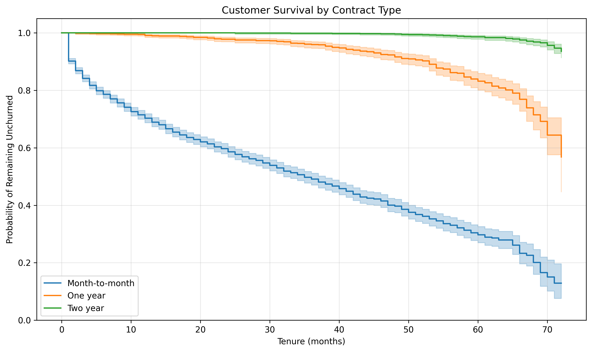
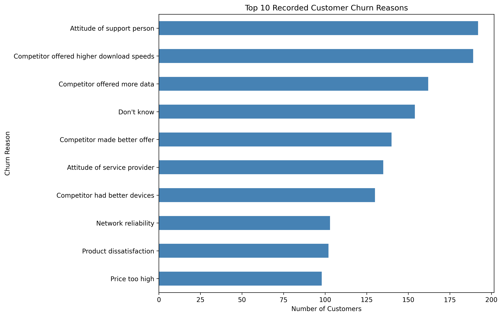
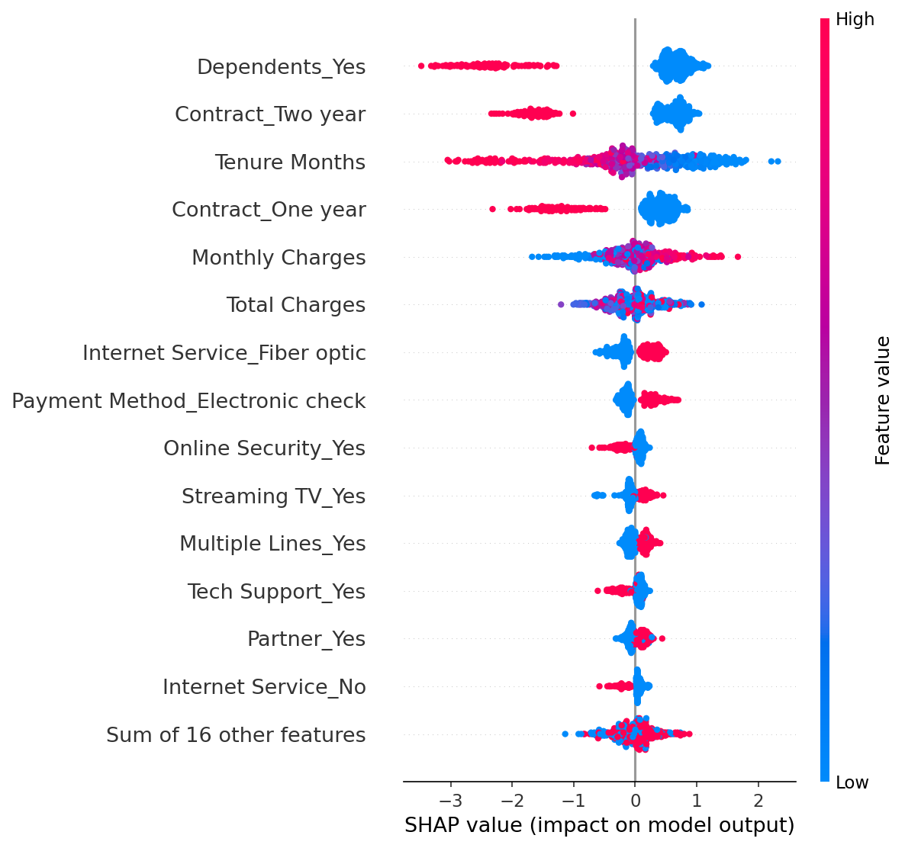
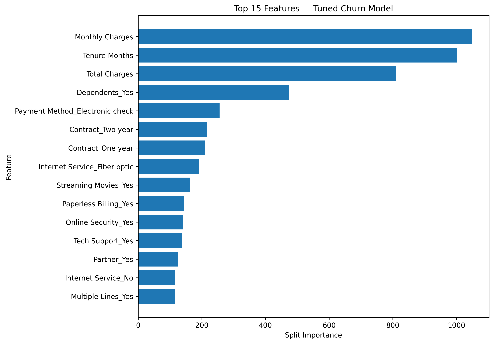
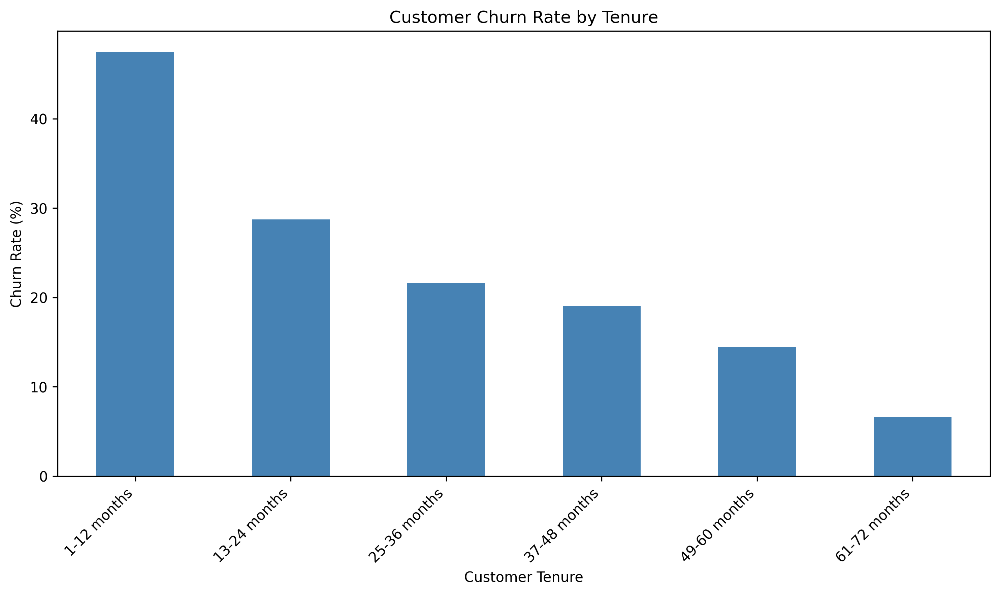

# Customer Churn Intelligence

An end-to-end data science project analyzing customer churn in the telecommunications industry using exploratory data analysis, machine learning, SHAP explainability, and survival analysis.

## Project Overview

Customer churn affects revenue, customer lifetime value, and business growth. This project analyzes customer behavior to identify churn patterns and develop data-driven customer retention strategies.

## Dataset

- **Total customers:** 7,043
- **Customers who churned:** 1,869
- **Overall churn rate:** 26.5%

## Key Findings

- Month-to-month customers have a 42.7% churn rate.
- Customers with one-year contracts have an 11.3% churn rate.
- Customers with two-year contracts have a 2.8% churn rate.
- Customers in their first 12 months have the highest observed churn rate, at 47.44%.
- Recorded churn reasons frequently include customer support issues and competitive offers.

## Technologies Used

- Python
- Pandas and NumPy
- Matplotlib
- Scikit-learn
- LightGBM
- SHAP
- Lifelines
- Git and GitHub

## Machine Learning Performance

A LightGBM classifier was optimized using 3-fold cross-validation and hyperparameter tuning.

### Tuned Model — Test Results

Evaluated on a held-out test set of 1,407 customers at a classification threshold of 0.50.

- **Accuracy:** 74.13%
- **Precision:** 50.85%
- **Recall:** 79.68%
- **F1-score:** 62.08%
- **ROC-AUC:** 84.97%

The model identified 298 of 374 actual churn cases, while incorrectly flagging 288 customers who did not churn.

### Model Optimization

- **Cross-validation ROC-AUC:** 86.53%
- **Algorithm:** LightGBM Classifier
- **Hyperparameter tuning:** Randomized parameter search with 3-fold cross-validation
- **Threshold selection:** Evaluated on validation data before final test evaluation

### Key Predictive Features

The model's feature-importance analysis identified the following leading predictors:

1. Monthly Charges
2. Tenure Months
3. Total Charges
4. Dependents
5. Payment Method
6. Contract Type

SHAP analysis was also used to investigate how features influence individual predictions.

**Note:** Feature importance indicates predictive contribution, not causation. Results should be validated before using the model to make customer-retention decisions.

## Visualizations

### Customer Survival by Contract Type



### Churn Reasons



### Churn Prediction Explainability



### Tuned Model Feature Importance



### Churn by Customer Tenure



## Business Recommendations

1. Improve onboarding and retention during the first 12 months.
2. Investigate customer support issues.
3. Review pricing, internet speeds, and data allowances against competitors.
4. Prioritize at-risk customers for targeted retention campaigns.
5. Measure campaign impact through controlled experiments.

## Project Structure

```text
DS-01-Churn-Intelligence/
├── data/
├── models/
├── reports/
│   ├── figures/
│   └── business_insights.md
├── churn_reasons_analysis.py
├── eda.py
├── explain_model.py
├── prepare_data.py
├── survival_analysis.py
├── tenure_churn_analysis.py
├── train_model.py
└── README.md
```

## Limitations

The analysis identifies patterns and associations, not necessarily causal relationships. Model results should be validated on unseen data, and retention strategies should be evaluated using measurable business outcomes.


